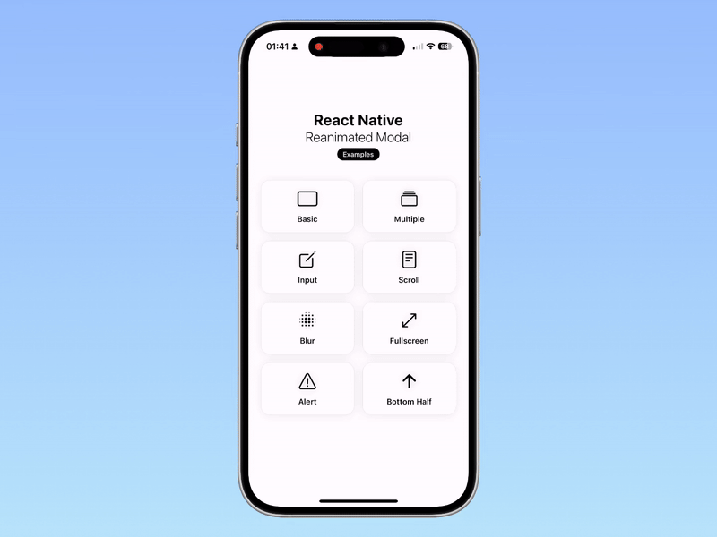

<div align="center">

# react-native-reanimated-modal

**A lightweight, performant modal for React Native — animations on the UI thread, swipe to dismiss in any direction, on top of the native Modal.**<br>
Built on React Native's own [`Modal`](https://reactnative.dev/docs/modal), so it behaves like one on every platform, with its animations and gestures in [Reanimated](https://docs.swmansion.com/react-native-reanimated/) and [Gesture Handler](https://docs.swmansion.com/react-native-gesture-handler/).

[](https://www.npmjs.com/package/react-native-reanimated-modal)
[](https://github.com/whidrubeld/react-native-reanimated-modal/actions/workflows/ci.yml)
[](https://bundlephobia.com/package/react-native-reanimated-modal)
[](src/types.ts)
[](LICENSE)

[**Documentation**](https://whidrubeld.github.io/react-native-reanimated-modal/) · [Getting started](https://whidrubeld.github.io/react-native-reanimated-modal/getting-started/) · [Animations](https://whidrubeld.github.io/react-native-reanimated-modal/animations/) · [Swipe](https://whidrubeld.github.io/react-native-reanimated-modal/swipe/) · [API](https://whidrubeld.github.io/react-native-reanimated-modal/api/modal/) · [Example app](https://whidrubeld.github.io/react-native-reanimated-modal/example/)



</div>

## Features

- **[Animations](https://whidrubeld.github.io/react-native-reanimated-modal/animations/)** — `fade`, `slide` from any edge and `scale`, at 60 fps on the UI thread.
- **[Your own animations](https://whidrubeld.github.io/react-native-reanimated-modal/custom-animations/)** — worklets for the content and the backdrop, on top of a preset or on their own.
- **[Swipe to dismiss](https://whidrubeld.github.io/react-native-reanimated-modal/swipe/)** — up, down, left, right, with a threshold and a spring back.
- **[Backdrop](https://whidrubeld.github.io/react-native-reanimated-modal/backdrop/)** — a color, your component (a blur), or none; presses close, call your handler, or do nothing.
- **[Declarative or imperative](https://whidrubeld.github.io/react-native-reanimated-modal/ref/)** — `visible` + `onHide`, or `ref.current.close()`.
- **[Several at once](https://whidrubeld.github.io/react-native-reanimated-modal/multiple-modals/)** — `coverScreen` stacks modals and works in React Navigation's `FullWindowOverlay`.
- **[Native behaviour](https://whidrubeld.github.io/react-native-reanimated-modal/platforms/)** — the Android back button, translucent bars, iOS orientations.
- **Small** — one component in TypeScript, no dependencies of its own.

## Install

```sh
npm install react-native-reanimated-modal
```

Peers: [`react-native-reanimated`](https://docs.swmansion.com/react-native-reanimated/docs/fundamentals/getting-started/), [`react-native-worklets`](https://docs.swmansion.com/react-native-worklets/docs/) and [`react-native-gesture-handler`](https://docs.swmansion.com/react-native-gesture-handler/docs/fundamentals/installation) — with Expo, `npx expo install react-native-reanimated react-native-worklets react-native-gesture-handler`.

> Version 1.2.5 and later need `react-native-worklets` 0.7.2+ (Expo SDK 55+). On Expo SDK 54 or Worklets 0.5.1, install `react-native-reanimated-modal@1.2.4`. [Version compatibility](https://whidrubeld.github.io/react-native-reanimated-modal/getting-started/#version-compatibility)

## Quick start

```tsx
import { useState } from 'react';
import { Button, Text, View } from 'react-native';
import { GestureHandlerRootView } from 'react-native-gesture-handler';
import { Modal } from 'react-native-reanimated-modal';

export default function App() {
  const [visible, setVisible] = useState(false);

  return (
    <GestureHandlerRootView style={{ flex: 1 }}>
      <Button title="Show modal" onPress={() => setVisible(true)} />

      <Modal
        visible={visible}
        onHide={() => setVisible(false)}
        animation={{ type: 'slide', direction: 'down' }}
        swipe={{ directions: ['down'] }}
      >
        <View
          style={{
            margin: 20,
            padding: 20,
            borderRadius: 12,
            backgroundColor: 'white',
          }}
        >
          <Text>Hello from the modal!</Text>
        </View>
      </Modal>
    </GestureHandlerRootView>
  );
}
```

Always pass `onHide` and set `visible` to `false` there: the modal calls it once the user has closed it — backdrop, swipe or back button — and its animation has finished.

Next: [the presets and their options](https://whidrubeld.github.io/react-native-reanimated-modal/animations/), [swipe directions](https://whidrubeld.github.io/react-native-reanimated-modal/swipe/), [every prop](https://whidrubeld.github.io/react-native-reanimated-modal/api/modal/).

## Example app


Scan the QR code with [Expo Go](https://expo.dev/go) to open the [example app](example) on your phone: a basic modal, a bottom sheet, full screen, blur, scroll, keyboard input, a toast and stacked modals. Or run it from the repository — `pnpm install && pnpm example start`.

<br clear="right">

## For AI assistants

Every page of the docs is also Markdown — [`llms.txt`](https://whidrubeld.github.io/react-native-reanimated-modal/llms.txt), [`llms-full.txt`](https://whidrubeld.github.io/react-native-reanimated-modal/llms-full.txt), [more](https://whidrubeld.github.io/react-native-reanimated-modal/llms/).

## Development

```sh
pnpm install          # the library, example/ and docs/ (one pnpm workspace)
pnpm example start    # the Expo example, on the library's source
pnpm validate         # typecheck, lint, unit tests, build
pnpm docs dev         # the documentation on http://localhost:4321/react-native-reanimated-modal/
```

The workflow, conventions and releases are in [CONTRIBUTING.md](CONTRIBUTING.md); architecture notes for coding agents in [AGENTS.md](AGENTS.md).

## License

[MIT](LICENSE)
